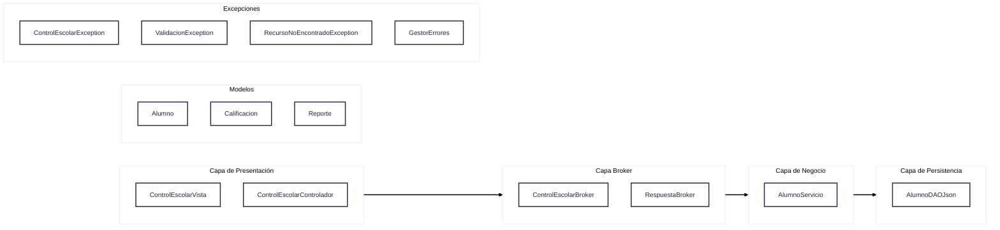

# Control Escolar
Un sistema basico para manejar las calificaciones de los alumnos y generar reportes.

# Dependencias
* Swing: Para la interfaz grafica
* Google Gson: Para el manejo de json.
Requiere Maven para compilarse.

# Diagramas

## Diagrama de arquitectura

## Diagrama de clases

```mermaid
---
config:
  theme: redux-color
---
classDiagram
    class Alumno {
        -String id
        -String matricula
        -String nombre
        -List~Calificacion~ calificaciones
        +getId() String
        +setId(String id) void
        +getMatricula() String
        +setMatricula(String matricula) void
        +getNombre() String
        +setNombre(String nombre) void
        +getCalificaciones() List~Calificacion~
        +agregarCalificacion(Calificacion c) void
    }

    class Calificacion {
        -String materia
        -double valor
        +getMateria() String
        +setMateria(String materia) void
        +getValor() double
        +setValor(double valor) void
    }

    class Reporte {
        -String alumnoId
        -String alumnoNombre
        -String alumnoMatricula
        -List~Calificacion~ calificaciones
        -double promedio
        -String estadoAprobacion
        -String fechaGeneracion
        +getPromedio() double
        +getEstadoAprobacion() String
    }

    Alumno "1" *-- "0..*" Calificacion
    Reporte "1" o-- "0..*" Calificacion

class IAlumnoDAO {
<<interface>>
+obtenerTodos() List~Alumno~
+obtenerPorId(String id) Optional~Alumno~
+obtenerPorMatricula(String matricula) Optional~Alumno~
+guardar(Alumno alumno) void
+actualizar(Alumno alumno) void
+eliminar(String id) void
}

class AlumnoDAOJson {
-Path rutaArchivo
-Gson gson
-Object bloqueo
+obtenerTodos() List~Alumno~
+obtenerPorId(String id) Optional~Alumno~
+obtenerPorMatricula(String matricula) Optional~Alumno~
+guardar(Alumno alumno) void
+actualizar(Alumno alumno) void
+eliminar(String id) void
}

IAlumnoDAO <|.. AlumnoDAOJson
AlumnoDAOJson ..> Alumno

class IAlumnoServicio {
<<interface>>
+registrarAlumno(String nombre, String matricula) Alumno
+eliminarAlumno(String id) void
+listarAlumnos() List~Alumno~
+buscarPorMatricula(String matricula) Optional~Alumno~
+buscarPorId(String id) Optional~Alumno~
+agregarCalificacion(String alumnoId, String materia, double valor) void
+calcularPromedio(String alumnoId) double
+generarReporte(String alumnoId) Reporte
}

class AlumnoServicio {
-IAlumnoDAO alumnoDAO
+registrarAlumno(String nombre, String matricula) Alumno
+eliminarAlumno(String id) void
+listarAlumnos() List~Alumno~
+buscarPorMatricula(String matricula) Optional~Alumno~
+buscarPorId(String id) Optional~Alumno~
+agregarCalificacion(String alumnoId, String materia, double valor) void
+calcularPromedio(String alumnoId) double
+generarReporte(String alumnoId) Reporte
}

IAlumnoServicio <|.. AlumnoServicio
AlumnoServicio --> IAlumnoDAO : usa
AlumnoServicio ..> Alumno
AlumnoServicio ..> Reporte

class RespuestaBroker~T~ {
-boolean exitoso
-String mensaje
-T datos
-String codigoError
+isExitoso() boolean
+getMensaje() String
+getDatos() T
+getCodigoError() String
+exito(T datos)$ RespuestaBroker~T~
+error(String mensaje)$ RespuestaBroker~T~
}

class IBroker {
<<interface>>
+registrarAlumno(String nombre, String matricula) RespuestaBroker~Alumno~
+eliminarAlumno(String id) RespuestaBroker~Void~
+listarAlumnos() RespuestaBroker~List~Alumno~~
+buscarPorMatricula(String matricula) RespuestaBroker~Alumno~
+agregarCalificacion(String alumnoId, String materia, double valor) RespuestaBroker~Void~
+calcularPromedio(String alumnoId) RespuestaBroker~Double~
+generarReporte(String alumnoId) RespuestaBroker~Reporte~
}

class ControlEscolarBroker {
-IAlumnoServicio alumnoServicio
+registrarAlumno(String nombre, String matricula) RespuestaBroker~Alumno~
+eliminarAlumno(String id) RespuestaBroker~Void~
+listarAlumnos() RespuestaBroker~List~Alumno~~
+buscarPorMatricula(String matricula) RespuestaBroker~Alumno~
+agregarCalificacion(String alumnoId, String materia, double valor) RespuestaBroker~Void~
+calcularPromedio(String alumnoId) RespuestaBroker~Double~
+generarReporte(String alumnoId) RespuestaBroker~Reporte~
}

IBroker <|.. ControlEscolarBroker
ControlEscolarBroker --> IAlumnoServicio : usa
ControlEscolarBroker ..> RespuestaBroker

class ControlEscolarControlador {
-IBroker broker
+obtenerAlumnos() List~Alumno~
+registrarAlumno(String nombre, String matricula) RespuestaBroker~Alumno~
+eliminarAlumno(String id) RespuestaBroker~Void~
+agregarCalificacion(String alumnoId, String materia, double valor) RespuestaBroker~Void~
+generarReporte(String alumnoId) RespuestaBroker~Reporte~
+obtenerPromedio(String alumnoId) double
}

class ControlEscolarVista {
-ControlEscolarControlador controlador
-JFrame ventana
-JTable tablaAlumnos
-DefaultTableModel modeloTabla
+iniciar() void
+recargarDatos() void
}

ControlEscolarVista --> ControlEscolarControlador : interactúa
ControlEscolarControlador --> IBroker : solicita

class ControlEscolarException {
-String codigo
+getCodigo() String
    }
class ValidacionException
class RecursoNoEncontradoException
class GestorErrores {
+registrarAdvertencia(String mensaje)$ void
+registrarFallo(String mensaje, Throwable causa)$ void
+extraerMensajeAmigable(Throwable t)$ String
    }

ControlEscolarException <|-- ValidacionException
ControlEscolarException <|-- RecursoNoEncontradoException
ControlEscolarBroker ..> GestorErrores
```
